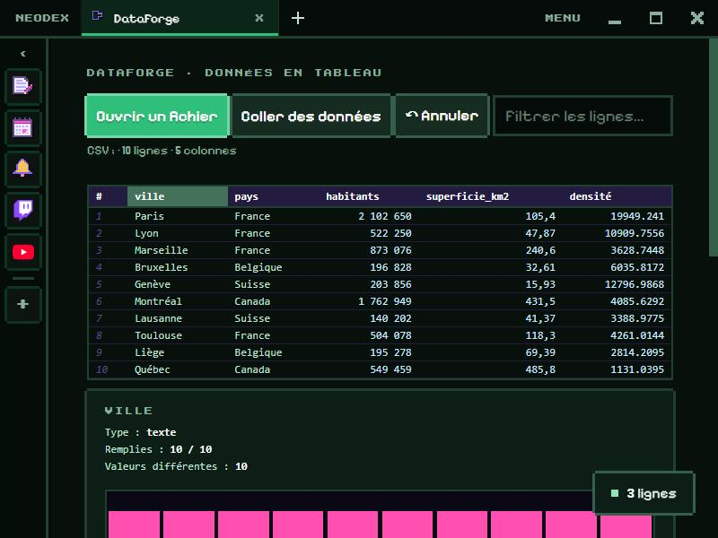

# DataForge

Open, explore and transform table data, without a spreadsheet.

*Version française : [README.md](README.md)*

## Opening

- **Open a file** (.csv, .tsv, .txt, .json, 30 MB at most) or **Paste data** (for example cells copied from a spreadsheet).
- The separator is guessed (`,` `;` tab `|`), quotes and line breaks inside a cell are handled, and both French-style (`1 234,5`) and English-style (`1,234.5`) numbers are recognised.
- In JSON: a list of objects (nested objects are kept as JSON text).

## Exploring

- **Click a header**: select the column; click again to sort (ascending, descending, unsorted).
- **Filter**: only show the rows that contain a word.
- For the selected column: type, filled cells, distinct values, and for numbers minimum, maximum, sum, mean, median and standard deviation. A chart shows the histogram of numbers or the most frequent values.

## Transforming

- Rename, delete, uppercase, remove extra spaces, remove duplicates or empty rows, keep only the filtered rows.
- **New column** computed by a formula: `[habitants] / [superficie_km2]`, `concat([ville], " (", [pays], ")")`, `si([prix] > 100, "expensive", "ok")`… The first row's result shows while you type. Formulas can only do calculations.
- **↶ Undo** (30 steps).

## Export

CSV (`,` or `;`), TSV, JSON, Markdown or SQL (`INSERT INTO`), to download or copy, in the sorted order, with every row or only the filtered ones.

## Data

The last opened table is kept in the plugin folder (unless it is very big). Permission: `storage` only.
