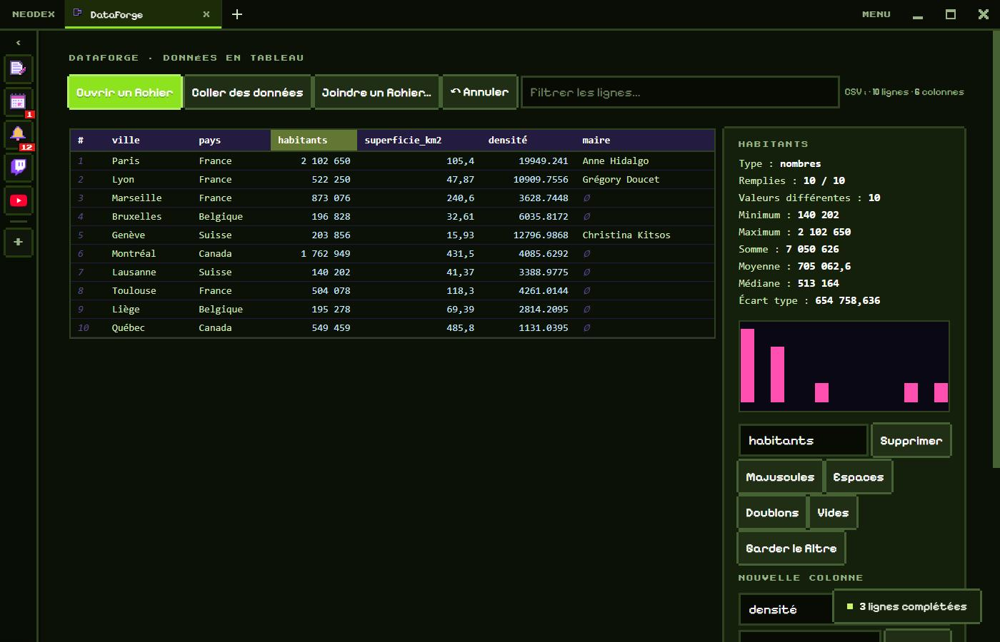

# DataForge

Open, explore and transform table data, without a spreadsheet.

*Version française : [README.md](README.md)*

## Steps and recipes (new in 1.2.0)

Every change to the table becomes a step. Keep them as a recipe, and replay it in one click on the table shown or on a new file (with its joins).

## Opening

- **Open a file** (.csv, .tsv, .txt, .json, 30 MB at most) or **Paste data** (for example cells copied from a spreadsheet).
- The separator is guessed (`,` `;` tab `|`), quotes and line breaks inside a cell are handled, and both French-style (`1 234,5`) and English-style (`1,234.5`) numbers are recognised.
- In JSON: a list of objects (nested objects are kept as JSON text).

## Exploring

- **Click a header**: select the column; click again to sort (ascending, descending, unsorted).
- **Filter**: only show the rows that contain a word.
- For the selected column: type, filled cells, distinct values, and for numbers minimum, maximum, sum, mean, median and standard deviation. A chart shows the histogram of numbers or the most frequent values.

## Transforming

- Rename, delete, uppercase, remove extra spaces, remove duplicates or empty rows, keep only the filtered rows.
- **New column** computed by a formula: `[habitants] / [superficie_km2]`, `concat([ville], " (", [pays], ")")`, `si([prix] > 100, "expensive", "ok")`… The first row's result shows while you type. Formulas can only do calculations.
- **↶ Undo** (30 steps).

## Export

CSV (`,` or `;`), TSV, JSON, Markdown or SQL (`INSERT INTO`), to download or copy, in the sorted order, with every row or only the filtered ones.

## Data

The last opened table is kept in the plugin folder (unless it is very big). Permission: `storage` only.

## Join, Excel and readability (1.1.0)

- **Join a file**: open a second file (CSV, TSV, JSON or Excel), pick your column and its column (DataForge suggests the one with the same name), then “Keep all my rows” or “Only matching rows”. Its columns are added on the right; case and surrounding spaces are ignored when comparing. Before joining, DataForge tells you how many of your rows find a match. ↶ Undo reverts the join.
- **Excel**: “Open a file” reads .xlsx (the first sheet; dates become dd/mm/yyyy) and export offers “Excel (.xlsx)”. Numbers, even in French notation, become real numbers in Excel; numbers starting with 0 stay text. The old .xls format is not read: save it as .xlsx first.
- **Readability**: larger text, and the table uses the window height.

## Steps and recipes (1.2.0)

Every change to the table is noted under **Steps**, at the bottom right: rename, delete a column, capitals, spaces, duplicates, empty rows, keep the filter, new computed column, join. **Undo** also removes the last step.

- **Save the recipe** keeps these steps under a name.
- **Replay here** applies them to the table shown; **On a file…** opens a file and applies them to it. Handy for the same export every month.
- Steps refer to columns by their **name**: the new file must have the same ones. If one is missing, nothing changes and DataForge says which step is blocking.
- A recipe with a join asks again for the file to join: pick it in the same window (Ctrl + click to take several).
