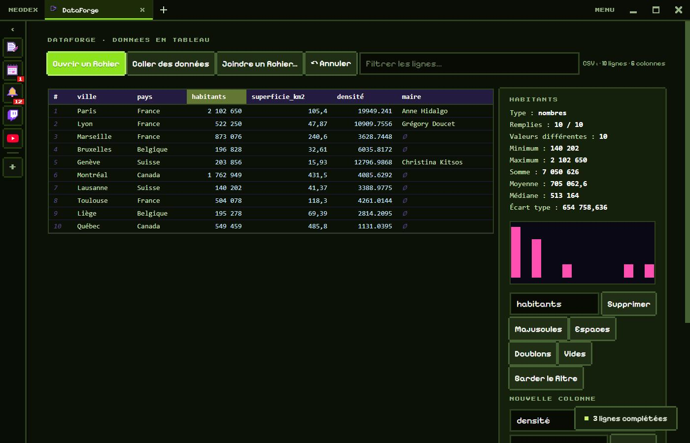

# DataForge

Ouvre, explore et transforme des données en tableau, sans tableur.

*English version: [README.en.md](README.en.md)*

## Étapes et recettes (nouveau en 1.2.0)

Chaque changement du tableau devient une étape. Garde-les en recette, et rejoue-la d'un clic sur le tableau affiché ou sur un nouveau fichier (avec ses jointures).

## Ouvrir

- **Ouvrir un fichier** (.csv, .tsv, .txt, .json, 30 Mo au plus) ou **Coller des données** (par exemple des cellules copiées depuis un tableur).
- Le séparateur est deviné (`,` `;` tabulation `|`), les guillemets et les retours à la ligne dans une cellule sont gérés, et les nombres à la française (`1 234,5`) comme à l'anglaise (`1,234.5`) sont reconnus.
- En JSON : une liste d'objets (les objets imbriqués sont gardés en texte JSON).

## Explorer

- **Clic sur un en-tête** : choisir la colonne ; re-clic pour trier (croissant, décroissant, sans tri).
- **Filtrer** : ne montrer que les lignes qui contiennent un mot.
- Pour la colonne choisie : type, cases remplies, valeurs différentes, et pour les nombres minimum, maximum, somme, moyenne, médiane et écart type. Un graphique montre l'histogramme des nombres ou les valeurs les plus fréquentes.

## Transformer

- Renommer, supprimer, mettre en majuscules, enlever les espaces en trop, enlever les doublons ou les lignes vides, ne garder que les lignes filtrées.
- **Nouvelle colonne** calculée par une formule : `[habitants] / [superficie_km2]`, `concat([ville], " (", [pays], ")")`, `si([prix] > 100, "cher", "ok")`… Le résultat de la première ligne s'affiche pendant qu'on écrit. Les formules ne peuvent faire que des calculs.
- **↶ Annuler** (30 étapes).

## Exporter

CSV (`,` ou `;`), TSV, JSON, Markdown ou SQL (`INSERT INTO`), à télécharger ou à copier, dans l'ordre du tri, avec toutes les lignes ou seulement celles filtrées.

## Données

Le dernier tableau ouvert est gardé dans le dossier du plugin (sauf s'il est très gros). Autorisation : `storage` seulement.

## Jointure, Excel et lisibilité (1.1.0)

- **Joindre un fichier** : ouvre un deuxième fichier (CSV, TSV, JSON ou Excel), choisis ta colonne et la sienne (DataForge propose d’office celle qui porte le même nom), puis « Garder toutes mes lignes » ou « Seulement celles qui correspondent ». Ses colonnes s’ajoutent à droite ; les majuscules et les espaces autour sont ignorés pour comparer. Avant de joindre, DataForge dit combien de tes lignes trouvent une correspondance. ↶ Annuler défait la jointure.
- **Excel** : « Ouvrir un fichier » lit les .xlsx (la première feuille ; les dates deviennent jj/mm/aaaa) et l’export propose « Excel (.xlsx) ». Les nombres, même écrits à la française, deviennent de vrais nombres dans Excel ; les numéros qui commencent par 0 restent du texte. L’ancien format .xls n’est pas lu : enregistre-le d’abord en .xlsx.
- **Lisibilité** : textes plus grands, et le tableau prend la hauteur de la fenêtre.

## Les étapes et les recettes (1.2.0)

Chaque changement du tableau est noté dans **Étapes**, en bas à droite : renommer, supprimer une colonne, majuscules, espaces, doublons, lignes vides, garder le filtre, nouvelle colonne calculée, jointure. **Annuler** retire aussi la dernière étape.

- **Enregistrer la recette** garde ces étapes sous un nom.
- **Rejouer ici** les applique au tableau affiché ; **Sur un fichier…** ouvre un fichier et les lui applique. Pratique pour le même export chaque mois.
- Les étapes désignent les colonnes par leur **nom** : le nouveau fichier doit avoir les mêmes. S’il en manque une, rien ne change et DataForge dit quelle étape bloque.
- Une recette qui contient une jointure redemande le fichier à joindre : choisis-le dans la même fenêtre (Ctrl + clic pour en prendre plusieurs).
