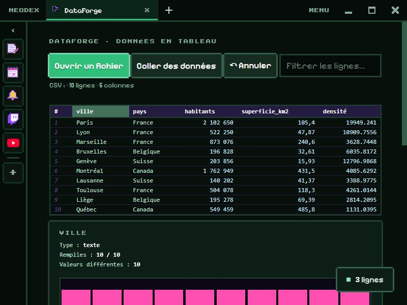

# DataForge

Ouvre, explore et transforme des données en tableau, sans tableur.

*English version: [README.en.md](README.en.md)*

## Ouvrir

- **Ouvrir un fichier** (.csv, .tsv, .txt, .json, 30 Mo au plus) ou **Coller des données** (par exemple des cellules copiées depuis un tableur).
- Le séparateur est deviné (`,` `;` tabulation `|`), les guillemets et les retours à la ligne dans une cellule sont gérés, et les nombres à la française (`1 234,5`) comme à l'anglaise (`1,234.5`) sont reconnus.
- En JSON : une liste d'objets (les objets imbriqués sont gardés en texte JSON).

## Explorer

- **Clic sur un en-tête** : choisir la colonne ; re-clic pour trier (croissant, décroissant, sans tri).
- **Filtrer** : ne montrer que les lignes qui contiennent un mot.
- Pour la colonne choisie : type, cases remplies, valeurs différentes, et pour les nombres minimum, maximum, somme, moyenne, médiane et écart type. Un graphique montre l'histogramme des nombres ou les valeurs les plus fréquentes.

## Transformer

- Renommer, supprimer, mettre en majuscules, enlever les espaces en trop, enlever les doublons ou les lignes vides, ne garder que les lignes filtrées.
- **Nouvelle colonne** calculée par une formule : `[habitants] / [superficie_km2]`, `concat([ville], " (", [pays], ")")`, `si([prix] > 100, "cher", "ok")`… Le résultat de la première ligne s'affiche pendant qu'on écrit. Les formules ne peuvent faire que des calculs.
- **↶ Annuler** (30 étapes).

## Exporter

CSV (`,` ou `;`), TSV, JSON, Markdown ou SQL (`INSERT INTO`), à télécharger ou à copier, dans l'ordre du tri, avec toutes les lignes ou seulement celles filtrées.

## Données

Le dernier tableau ouvert est gardé dans le dossier du plugin (sauf s'il est très gros). Autorisation : `storage` seulement.
